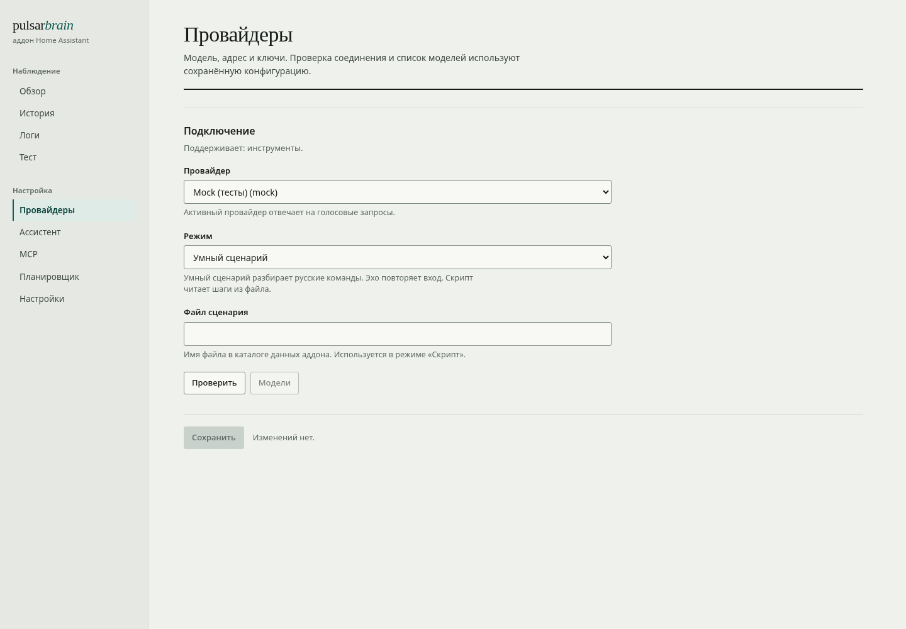
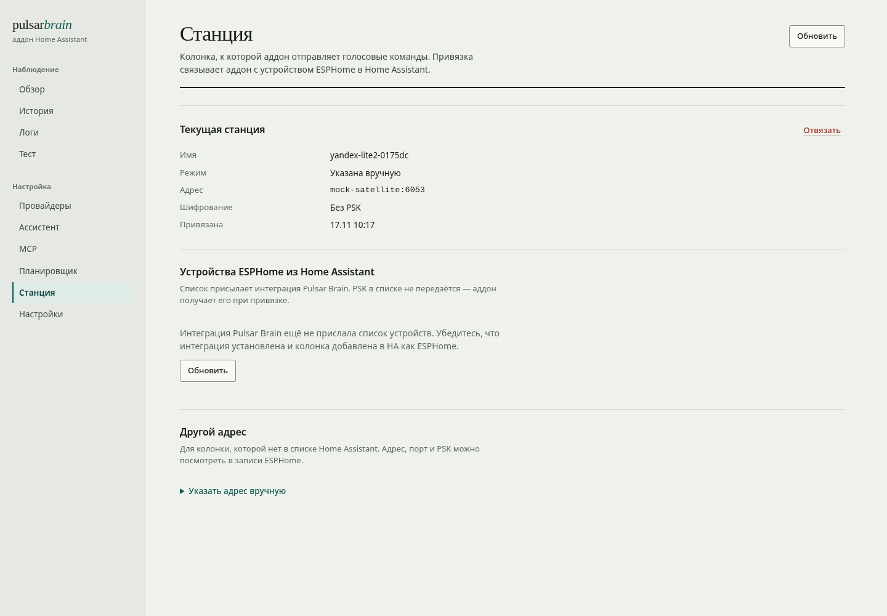

# pulsar-brain

Голосовой ассистент для Яндекс Станции с прошивкой [pulsar](https://github.com/Morvex885/pulsar):
свой «мозг» вместо штатного Assist-пайплайна Home Assistant. Колонка остаётся ESPHome-сателлитом
с родным wake word «Алиса», а распознавание, LLM, инструменты, MCP, таймеры и веб-настройка живут
в HA-аддоне.

Проект состоит из двух частей:

- **`addon/`** — HA-аддон («мозг»): Node.js 22 + TypeScript, Fastify, SQLite, SPA.
- **`custom_components/pulsar_brain/`** — Python-интеграция («мост»): только транспорт между
  ESPHome-сателлитом и аддоном.

Архитектура — [docs/architecture.md](docs/architecture.md), контракты — [docs/contracts.md](docs/contracts.md),
текущий статус и проверки — [docs/status.md](docs/status.md).



## Архитектура

```
┌──────────────────────────────────────────────────────────────────────┐
│ Яндекс Станция Лайт 2 (plum), прошивка pulsar v0.5.3                  │
│ wake word «Алиса», локальные команды, микрофон, кольцо, media_player  │
└───────────────────────────────┬──────────────────────────────────────┘
                                │ ESPHome Native API :6053 (Noise/PSK)
                                │ PCM 16 кГц, моно; события voice assistant
                                ▼
┌──────────────────────────────────────────────────────────────────────┐
│ custom_components/pulsar_brain — Python-мост в Home Assistant         │
│ ESPHome VA-клиент, приём/передача аудио, публикация WAV по URL        │
└───────────────────────────────┬──────────────────────────────────────┘
                                │ WebSocket /api/bridge/ws, Bearer-токен
                                ▼
┌──────────────────────────────────────────────────────────────────────┐
│ Аддон Pulsar Brain :8097 — Node.js 22 + TypeScript                    │
│  ├─ ASR   → Wyoming Whisper :10300                                    │
│  ├─ TTS   → Wyoming Piper :10200 (или голос провайдера)               │
│  ├─ LLM   → OpenAI-совместимый | OpenClaw | Gemini Live | mock        │
│  ├─ Tools → HA Core API, MCP-серверы, планировщик (SQLite)            │
│  └─ UI    → ingress Home Assistant (наружу порт не публикуется)       │
└──────────────────────────────────────────────────────────────────────┘
```

Один голосовой цикл — одно WebSocket-соединение «мост → аддон». Мост не решает, что ответить, и не
вызывает сервисы HA: он передаёт сырой PCM и события, а обратно получает события для ESPHome и
готовый WAV-файл ответа.

Особенность pulsar: колонка **не принимает потоковое TTS-аудио**, она играет ответ по URL из
`TTS_END.url`. Поэтому аддон синтезирует ответ целиком, мост публикует WAV на своём HA-view и
отправляет ссылку колонке. Follow-up — это новый run с пустой wake word; история диалога хранится
в аддоне.

## Возможности

- **Голос.** Родная «Алиса», распознавание речи (Whisper), ответ LLM, озвучка (Piper или голос
  провайдера), barge-in и follow-up без повторного wake word.
- **Несколько действий из одной фразы** и голосовое подтверждение результата.
- **Таймеры и отложенные действия.** «Включи свет на 10 минут», «выключи в 22:00», отмена и список —
  в SQLite аддона, переживают перезапуск. Повторяющиеся правила («каждый день в 8») превращаются в
  нативные automation HA.
- **Инструменты Home Assistant.** Вызов сервисов, состояния и список сущностей, медиа и громкость,
  announce.
- **MCP.** Подключение внешних серверов по HTTP, SSE или stdio; инструменты видны LLM как
  `mcp.<server>.<tool>`.
- **Провайдеры LLM.** OpenAI-совместимый endpoint, OpenClaw, Gemini Live (speech-to-speech) и
  `mock` для тестов без ключей. Проверка соединения и список моделей — из UI.
- **Веб-админка** (русский): Обзор, История, Логи, Тест, Провайдеры, Ассистент, MCP, Планировщик,
  Настройки. За ingress аутентификацию выполняет HA; при прямом доступе нужен UI-токен.
- **Диагностика в HA.** Сущности соединения, последней фразы и ответа, переключатель моста,
  выбор провайдера, кнопка перезапуска; сервисы `pulsar_brain.ask` и `pulsar_brain.announce`.

## Требования

- Колонка с прошивкой pulsar (целевое устройство — Лайт 2, плата `plum`, pulsar v0.5.3), добавленная
  в HA как ESPHome-устройство. Для подключения нужен Noise PSK колонки.
- **Home Assistant OS или Supervised** — аддоны требуют Supervisor. HA >= 2025.x.
- Архитектура `aarch64` или `amd64`.
- Wyoming-сервисы: **Whisper** (STT) и **Piper** (TTS). Подойдут официальные аддоны
  `core-whisper` / `core-piper` (хосты `core-whisper:10300`, `core-piper:10200`) или любые
  доступные по сети Wyoming-серверы.
- Node.js на хосте **не нужен**: Node 22 и все зависимости находятся внутри образа аддона.
- Колонка должна уметь скачать WAV по URL Home Assistant (`internal_url`), иначе ответ не
  проиграется.
- Для локального стенда: Docker с compose v2, Python 3.12+ для `dev/.venv`.

## Быстрый старт на dev-стенде

Стенд поднимает HA Core в Docker (порт 8124), Whisper (10300), Piper (10200) и аддон (8097).
Supervisor в нём нет, поэтому ingress и `SUPERVISOR_TOKEN` здесь не проверяются.

```sh
cd dev
docker compose up -d ha whisper piper
cd ..
dev/.venv/bin/python dev/bootstrap-ha.py   # onboarding HA, пользователь dev/devpass, токен
dev/check.sh                              # ожидаем все [ OK ]
scripts/install-local.sh                  # образ, контейнер аддона, интеграция, restart HA
```

`scripts/install-local.sh` идемпотентен: пересобирает образ, пересоздаёт контейнер
`pulsar-brain-addon`, ждёт `/health`, копирует интеграцию в `dev/ha-config/custom_components/` и
перезапускает HA. Данные аддона лежат в named volume `pulsar-brain-data` и не теряются.

После установки:

- UI аддона — <http://127.0.0.1:8097/>;
- HA — <http://127.0.0.1:8124/> (логин `dev`, пароль `devpass`);
- провайдер — `mock` (`PULSAR_BRAIN_MOCK=1`), ключи не нужны;
- добавить интеграцию: **Настройки → Устройства и службы → Добавить интеграцию → Pulsar Brain**,
  адрес `pulsar-brain-addon`, порт `8097`, bridge token из UI аддона.

Первая загрузка моделей Whisper/Piper занимает 1–2 минуты и требует сети. Подробности стенда —
[dev/README.md](dev/README.md), установка и типовые ошибки — [docs/install.md](docs/install.md).

## Установка на Home Assistant OS

Ставятся две части, но вручную вводить адреса и токены не нужно: аддон сам объявляет себя
Home Assistant через Supervisor discovery, а колонка выбирается в админке аддона. Подробный разбор
с ожидаемыми результатами и ошибками — [docs/install.md](docs/install.md).

### 1. Аддон

1. **Настройки → Аддоны → Магазин** (в новых версиях — **Приложения**) → ⋮ → **Репозитории**.
2. Добавь URL репозитория аддонов: `https://github.com/Thedamem/pulsar-brain` (или локальный
   git-сервер с этим репозиторием, доступный Supervisor'у).
3. Установи **Pulsar Brain** → **Запустить**. Supervisor соберёт образ из `addon/Dockerfile` на
   устройстве (первая сборка занимает несколько минут и требует сеть для `npm ci`).

Локальный вариант без репозитория: скопируй каталог `addon/` в `/addons/pulsar_brain` и нажми
⋮ → **Reload** в магазине ([docs/install.md](docs/install.md), §2.3).

### 2. Интеграция

HACS и встроенный Marketplace читают репозитории **только с публичного GitHub**. Установи
интеграцию любым способом:

- **HACS / Marketplace:** HACS → ⋮ → **Custom repositories** → `https://github.com/Thedamem/pulsar-brain`
  → category **Integration** → установить **Pulsar Brain**.
- **Вручную из релиза:**

  ```sh
  cd /config
  wget -O /tmp/pulsar_brain.zip \
    https://github.com/Thedamem/pulsar-brain/releases/download/v0.3.0/pulsar_brain.zip
  unzip -o /tmp/pulsar_brain.zip -d /config
  ha core restart
  ```

После перезапуска HA покажет **обнаруженную интеграцию Pulsar Brain**. Нажми **Настроить** —
полей нет, всё уже передано аддоном. Если автообнаружение не сработало (аддон был установлен
позже интеграции), перезапусти HA или добавь интеграцию вручную: hostname и bridge token показаны
в аддоне в **Настройках**.

### 3. Привязка колонки

1. Открой панель аддона: **Настройки → Аддоны → Pulsar Brain → Open Web UI**.
2. Раздел **Станция** → выбери колонку в списке **Устройства ESPHome из Home Assistant** →
   **Привязать**. Список присылает интеграция; аддон передаёт выбор обратно в HA.
3. Если колонки нет в списке (не добавлена в HA как ESPHome-устройство), раскрой **Другой адрес**
   и укажи host/port и Noise PSK вручную (PSK виден в записи интеграции ESPHome).



После привязки появятся `binary_sensor.connection`, `sensor.station`,
`sensor.last_transcript/last_response`, `select.provider`, `switch.enabled`,
`button.restart_bridge` и сервисы `pulsar_brain.ask` / `pulsar_brain.announce`. Скажи
«Алиса, включи свет» — колонка ответит и выполнит действие.

## Настройка

Все настройки — в UI аддона; они сохраняются в `/data/config.json`, секреты шифруются
AES-256-GCM (`master.key` рядом, права `0600`). В UI секреты показываются маской.

### Провайдеры LLM

**Провайдеры → выбрать → заполнить → Проверить → Сохранить.**

| Провайдер | Поля | Примечание |
|---|---|---|
| OpenAI-совместимый | `baseUrl`, `apiKey`, `model`, `temperature`, `maxTokens`, `extraHeaders` | Подходит OpenAI, OpenRouter, vLLM, Ollama и другие `/v1/chat/completions` |
| OpenClaw | `baseUrl`, `apiKey`, `agentId`, `model` | Отдельный API, не OpenAI-совместимый |
| Gemini Live | `apiKey`, `model`, `voice`, `responseModality` | Speech-to-speech; ответ буферизуется целиком (см. ограничения) |
| `mock` | `mode`: `smart`, `echo`, `scripted` | Без ключей; детерминированные сценарии, помечен в UI |

STT и TTS настраиваются на странице **Ассистент**: хост/порт/язык Whisper, хост/порт/голос Piper,
режим озвучки (`piper`, `provider`, `auto`), параметры VAD. Кнопка предпросмотра TTS отдаёт WAV.

### MCP

**MCP → Добавить сервер.** Поддерживаются транспорты `http`, `sse` и `stdio`. Для HTTP/SSE нужен
URL (и заголовки, если требуется авторизация), для stdio — команда и аргументы. Таймаут вызова
задаётся на сервер. Кнопка «Проверить» подключается и показывает инструменты; LLM видит их как
`mcp.<server>.<tool>`.

Для stdio-серверов исполняемый файл должен быть **внутри образа аддона**: runtime-образ содержит
только Node 22 и зависимости проекта. Внешние MCP-серверы удобнее подключать по HTTP/SSE.

### Планировщик

**Планировщик** показывает активные разовые таймеры и отложенные действия, позволяет отменить или
выполнить сейчас. Они хранятся в SQLite в `/data` и восстанавливаются после перезапуска.
Повторяющиеся правила создаются как нативные automation HA — так они переживают простой аддона и
видны в HA. Время интерпретируется в часовом поясе контейнера; если он отличается от HA, проверь
`date` внутри контейнера.

### Промпт и алиасы

**Ассистент** — системный промпт, язык, лимит истории, follow-up-окно, barge-in, лимит итераций
инструментов. **Настройки** — алиасы «понятное имя → entity_id», уровень логов, токены.

## Известные ограничения

- **Нет живых ключей провайдеров.** Проверены только `mock`-сценарии; OpenAI-совместимый, OpenClaw
  и Gemini Live реализованы по документации и требуют проверки с реальными ключами.
- **Gemini Live буферизует ответ.** Колонка играет WAV по URL, потоковая отдача невозможна, поэтому
  speech-to-speech ответ сначала генерируется целиком — это добавляет задержку.
- **Локальные команды pulsar остаются на устройстве.** Прошивка обрабатывает их сама; ассистент не
  перехватывает и не отменяет их.
- **Always-on без «Алисы» не поддерживается.** Новый диалог начинается по wake word или кнопке.
- **Слот voice assistant.** Мост подписывается на VA и держит слот: штатный Assist на этой колонке
  перестаёт работать. Выключение `switch.enabled` освобождает слот.
- **PSK колонки.** Без Noise PSK живое подключение к станции невозможно; в dev-стенде используется
  mock-сателлит без шифрования.
- **TTS по URL.** Колонка должна достать WAV по `internal_url` HA; если станция не видит этот адрес,
  ответ не проиграется.
- **Dev-стенд без Supervisor.** Ingress, `SUPERVISOR_TOKEN`, `hassio_api` и watchdog проверяются
  только при установке на HAOS.
- **Контейнер работает от root.** Supervisor монтирует `/data` с владельцем root; менять владельца
  образа нельзя, иначе аддон не сможет писать конфиг, ключ и SQLite.
- **Порт наружу не публикуется.** UI — только ingress; это осознанное ограничение, а не недоделка.
- **MCP stdio** ограничен бинарниками внутри образа (см. выше).
- **Существующий прод-инстанс HA в проверках не участвует.** Установка проверяется на локальном
  стенде и HAOS.

## Структура репозитория

```
addon/                         HA-аддон (Node.js 22 + TypeScript)
  config.yaml                  манифест аддона
  Dockerfile                   multi-stage: backend → web → runtime
  src/                         мозг: config, server, session, audio, llm, tools, mcp, scheduler
  web/                         SPA (Vite + React), собирается в web/dist
  tests/                       unit-тесты модулей
custom_components/pulsar_brain/  Python-мост: ESPHome VA, WS-клиент аддона, сущности, сервисы
dev/                           локальный стенд: compose, bootstrap-ha.py, check.sh, ha-config
tests/                         mock-сателлит ESPHome, тесты моста, e2e-сценарии
custom_components/pulsar_brain/brand/  brand-ассеты интеграции для HA/HACS
scripts/                       check-all.sh, install-local.sh, publish-local.sh, make-release.sh
docs/                          architecture, contracts, install, publishing, status, исследования
hacs.json                      манифест HACS/Marketplace
repository.yaml                манифест репозитория аддонов для Supervisor
AGENTS.md                      правила работы с репозиторием для агентов
```

## Проверки

```sh
scripts/check-all.sh           # tsc, vitest, сборка SPA, py_compile, pytest, bash -n, YAML, docker build
```

Скрипт печатает `[ OK ]`, `[FAIL]`, `[SKIP]` и падает только на `FAIL`. Отсутствующий каталог —
`SKIP` с причиной; на финальном прогоне SKIP быть не должно.

## Лицензия и статус

- Версия **0.3.0**, gate перед релизом — `scripts/check-all.sh`.
- **Лицензия не выбрана** — файл `LICENSE` пока отсутствует, образ помечен
  `LicenseRef-Proprietary`. Добавление лицензии — отдельное решение maintainer'а.
- Провайдеры, кроме `mock`, не проверены живыми ключами; это явно отмечено в отчётах и UI.
- Порядок релизов и публикации — [docs/publishing.md](docs/publishing.md).
