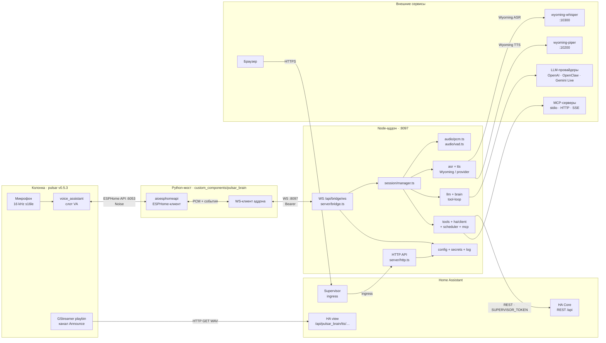
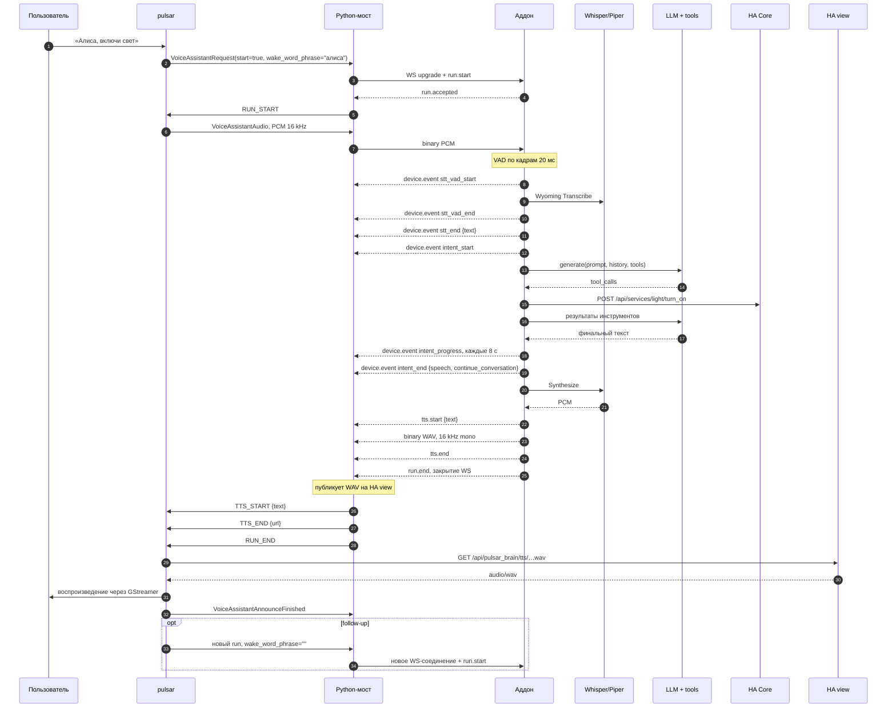

# Архитектура pulsar-brain

Документ для разработчика, который впервые открыл репозиторий: из чего состоит система, где
проходят границы модулей, как живёт один голосовой run и что ещё не готово.

Источники: [docs/contracts.md](contracts.md), [docs/status.md](status.md) и код
`addon/src/**`, `dev/**`, `custom_components/pulsar_brain/**`. Расхождения кода с контрактом
отмечены явно.

Срез: **2026-11-16, 12:21 MSK**. Репозиторий в активной параллельной разработке; статусы ниже
относятся к этому срезу. Обозначения: **реализовано** — код есть и делает описанное; **частично** —
есть каркас/часть пути; **не реализовано** — кода нет, есть только контракт или план.

## 1. Обзор и границы

**Задача.** Заменить голосовой конвейер Home Assistant для колонки «Яндекс Станция Лайт 2» с
прошивкой [pulsar](https://github.com/Morvex885/pulsar) v0.5.3: свой LLM, инструменты, MCP,
планировщик, история и веб-настройки, но установка остаётся штатной для HA (аддон + интеграция).

**Две части в одном репозитории:**

- `addon/` — HA-аддон на Node.js 22 + TypeScript: конфиг и секреты, HTTP API и UI, WS-приёмник
  моста, сессии, VAD, STT/TTS, LLM/brain, инструменты HA и MCP, планировщик.
- `custom_components/pulsar_brain/` — Python-интеграция HA, только транспорт: ESPHome VA-клиент,
  приём/передача PCM, публикация WAV по URL, сущности диагностики, сервис `pulsar_brain.ask`.
  Есть `__init__.py`, `config_flow.py`, `services.py`, WS/ESPHome-клиенты, WAV и TTS-view;
  нет манифеста, переводов и файлов платформ.

**Почему не штатный Assist-пайплайн.** HA Assist фиксирует цепочку STT → agent → TTS и не даёт
управлять порядком событий ESPHome, таймаутами pulsar и собственным tool-loop. Нужны любой
LLM-провайдер, MCP-инструменты, разовые таймеры в аддоне, повторяющиеся действия нативными
автоматизациями HA (BRIEF §4 п. 6) и собственная админка. HA остаётся источником устройств и
сущностей, а не транспортом речи.

**Границы:** мост не содержит бизнес-логики (contracts §1); аддон не подключается к ESPHome
напрямую (contracts §8); прошивка pulsar не модифицируется.

## 2. Схемы

### 2.1. Компоненты и протоколы

Порты: ESPHome API `6053/TCP` (Noise), Wyoming `10300` (ASR) и `10200` (TTS), аддон `8097`
(HTTP + WS + ingress), HA `8123` (в dev-стенде `8124`). У pulsar также заняты `8928` (Sendspin),
`6638` (deCONZ), `6054/UDP` (арбитраж wake word) — не используются
([research-pulsar.md](research-pulsar.md), `docs/voice.md` pulsar).

### 2.2. Один голосовой run

Оговорки к диаграмме, важные для реализации:

- `RUN_START` и `STT_START` мост отправляет сам при открытии run (`BRIDGE_OWNED_EVENTS` в
  `custom_components/pulsar_brain/events.py`), а не пересылает из аддона; тест порядка в `addon/tests/session.test.ts`
  начинается со `stt_start`. Это расхождение с contracts §3.2, где первым назван `run_start`.
- `TTS_START`/`TTS_END`/`RUN_END` в ESPHome отправляет Python-мост после получения `tts.end`;
  аддон этих `device.event` не шлёт. Мост должен успеть отправить `TTS_END` до `RUN_END`, иначе
  pulsar завершит диалог до воспроизведения (`docs/voice.md` и `voice.rs` в репозитории pulsar).
- Пунктирные стрелки — сообщения WS-протокола (`device.event`, `run.accepted`, `tts.*`), сплошные —
  реальные сетевые вызовы.

## 3. Модули: ответственности и границы

### 3.1. Реализованные модули

| Модуль | Файлы | Что делает | Чего не делает |
|---|---|---|---|
| Контракты | `addon/src/shared/types.ts`, `addon/src/shared/protocol.ts` | Доменные типы (`AppConfig`, `ProviderLike`, `Tool`, `SttLike`, `TtsLike`, `AppServices`), WS и HTTP DTO, `PROTOCOL_VERSION = 1` | Нет runtime-логики и валидации |
| Композиционный корень | `addon/src/index.ts` | Создаёт все сервисы, связывает зависимости, поднимает планировщик, HTTP и WS, упорядоченно останавливает их | Не содержит бизнес-логики; порядок и владение сервисами — только здесь |
| Конфиг и секреты | `addon/src/config/schema.ts`, `addon/src/config/store.ts`, `addon/src/secrets/crypto.ts` | Zod-схема и дефолты, load/save `/data/config.json`, сериализованные обновления, deep merge, AES-256-GCM, маскирование, env-override, bridge-токен | Не читает `/data/options.json`, не проверяет межполевые ограничения; нет ротации ключей |
| Логи | `addon/src/log/logger.ts` | Ring buffer 2000 записей, JSON-строки в stdout, scoped-логгеры, redaction, `since()`/`subscribe()` для SSE | Не пишет файлы |
| HTTP API | `addon/src/server/http.ts`, `auth.ts`, `ui-static.ts` | Все роуты contracts §4, Bearer/ingress, zod-валидация, SSE логов, multipart для теста аудио, отдача UI и SPA-fallback, единый формат ошибок | Не запускает WS и не содержит бизнес-логики — вызывает `AppServices` |
| WS-мост | `addon/src/server/bridge.ts` | `WS /api/bridge/ws`, одно соединение = один run, zod-схемы, `run.accepted`, `device.event`, `tts.start` + WAV + `tts.end`, `run.end`, таймауты рукопожатия/отправки/закрытия | Не делает STT/TTS и не публикует WAV; `RUN_START`/`STT_START` эмитит Python-мост |
| Сессии | `addon/src/session/manager.ts`, `history.ts` | Состояния run/turn, PCM → VAD → STT → brain → TTS, `intent_progress` каждые 8 с, barge-in, SQLite-история, вырезание wake word | Не знает про WS/HTTP, не ресемплит, не отправляет `run_start`/`tts_*`, не читает `conversation.bargeIn` |
| Аудио | `addon/src/audio/pcm.ts`, `addon/src/audio/vad.ts` | PCM16, parse/encode WAV, `resampleLinear`, RMS/peak dBFS; энергетический VAD по кадрам 20 мс с pre-roll и лимитами | Нет потокового ресемплера, антиалиасинга и эхоподавления |
| ASR и TTS | `addon/src/asr/wyoming.ts`, `addon/src/tts/wyoming.ts`, `addon/src/tts/provider.ts`, `addon/src/tts/resample.ts` | Wyoming JSONL/TCP клиент, ASR-поток, Piper, OpenAI-совместимый `/audio/speech` (wav/pcm), ресемплинг в 16 кГц и чанки 32 мс, голоса и health | Нет mp3/opus-декодера и потокового синтеза; Wyoming без auth/TLS |
| LLM и brain | `addon/src/llm/*.ts`, `addon/src/brain/orchestrator.ts`, `addon/src/brain/prompt.ts` | Реестр из четырёх провайдеров, SSE + tool calls + abort, Gemini Live WS с native audio 24→16 кГц, mock; сборка промпта с временем и алиасами, tool-loop до `llmMaxToolIterations`, история | OpenClaw и Gemini не проверены живыми ключами; нет fallback между провайдерами и сжатия истории |
| HA-клиент и инструменты | `addon/src/ha/client.ts`, `addon/src/tools/ha.ts` | REST к `http://supervisor/core/api` или override: сервисы, состояния, сущности; `ha.call_service`, `ha.get_state`, `ha.list_entities`, `media.*`, `announce.say` | Нет HA WebSocket API и реестра зон; POST не ретраится |
| Реестр инструментов | `addon/src/tools/registry.ts` | Регистрация, `specs()`, `execute()` с разбором JSON и проверкой `required`, `removeByPrefix` для MCP, ошибки → `ToolResult` | Нет полной JSON-Schema-валидации |
| MCP | `addon/src/mcp/client.ts`, `addon/src/mcp/manager.ts`, `addon/src/mcp/schema.ts`, `addon/src/mcp/errors.ts`, `addon/src/tools/mcp.ts` | Три транспорта, namespace `mcp.<serverId>.<tool>`, таймауты, reconnect 1/2/5/10/30 с, состояния серверов, адаптер в `Tool` | Нет resources/prompts, OAuth и кеша между рестартами |
| Планировщик | `addon/src/scheduler/*.ts`, `addon/src/tools/scheduler.ts`, `addon/src/schedule/*.ts` | SQLite `scheduler.db`, one-shot, recovery с grace 5 мин, `maxActive`, `add_once`/`cancel`/`list`/`add_recurring`, разбор русских повторов, нативная HA-автоматизация или внутренний fallback | Нативная автоматизация требует admin-токена; редактирования автоматизаций нет |
| Веб-UI | `addon/web/**` (Vite + React), собирается в `addon/web/dist` | Экраны обзора, провайдеров, ассистента, MCP, планировщика, истории, логов, настроек и теста; русский интерфейс | Не проверялся в браузере на 360/768/1440; тяжёлых UI-библиотек нет |

### 3.2. Спроектировано, не реализовано

| Часть | Состояние на срезе | Что должно делать |
|---|---|---|
| Python-мост: HA-обвязка | В `custom_components/pulsar_brain/` есть `__init__.py`, `config_flow.py`, `services.py`, `bridge.py`, `esphome_client.py`, `tts_view.py`; нет `manifest.json`, `translations/` и платформ `sensor`/`binary_sensor`/`select`/`switch`/`button` | Манифест и переводы, чтобы HA загрузил компонент; диагностические платформы и проверка setup/unload |
| E2E и тесты моста | Есть инфраструктура `tests/e2e/` (`harness.py`, `bridge_client.py`, `fake_ha.py`); сценариев нет, `tests/bridge` пуст | Прогон «mock-сателлит → мост → аддон → mock LLM → Piper» и сценарии BRIEF §2 |

## 4. Жизненный цикл run и turn

**Определения.** Run — один голосовой запрос ESPHome, то есть одно WS-соединение
`/api/bridge/ws`. Turn — одна реплика внутри run: STT → brain → TTS. Менеджер содержит ровно один
turn на run; follow-up — это **новый run** (contracts §3).

**Состояния менеджера:** `listening` → `processing` → `speaking` → `finished`. Переходы: PCM в
`listening`; `speech_end` VAD или текст — в `processing`; начало синтеза — в `speaking`; любой
финал — в `finished` с записью в `sessions.db`.

**События.** Менеджер отправляет `stt_start` (сразу), `stt_vad_start`, `stt_vad_end`, `stt_end
{text}`, `intent_start`, `intent_progress` (каждые 8 с), `intent_end {speech, continue_conversation}`,
`error`. WAV ответа отдаётся через `RunSink.tts(wav, text)`, закрытие run — `RunSink.end(reason)` →
`run.end`. `RUN_START`, `STT_START`, `TTS_*` и `RUN_END` мост формирует сам
(`BRIDGE_OWNED_EVENTS`), копии этих событий из аддона игнорирует.

**Таймауты и keepalive:**

| Что | Значение | Где |
|---|---|---|
| Рукопожатие моста (ожидание `run.start`) | 5 с | `addon/src/server/bridge.ts` |
| Нет речи после `stt_start` | 10 с → `stt-no-text-recognized`, `no_speech` | `addon/src/session/manager.ts` |
| Финализация STT / синтез TTS | 30 с / 30 с | `addon/src/session/manager.ts` |
| Период `intent_progress` | 8 с | `addon/src/session/manager.ts` |
| Отправка WS-фрейма / закрытие / страховка после cancel | 20 с / 2 с / 3 с | `addon/src/server/bridge.ts` |
| Watchdog pulsar: Listening / Processing | 30 с / 120 с, перезаряжается принятым событием | `satellite/crates/pulsar/src/controller/mod.rs`, `voice.rs` |

`intent_progress` шлётся с `tts_start_streaming: "0"`: по флагу `"1"` pulsar пытается начать
воспроизведение из уже известного URL, а у нас URL появляется только в `TTS_END`. 8 с < 120 с,
поэтому watchdog Processing не срабатывает даже на длинном ответе.

**Barge-in и отмена.** Новый `startRun` отменяет все активные run'ы с причиной `barge_in` — флаг
`conversation.bargeIn` не читается. При прерывании pulsar шлёт `handle_stop(abort=True)`, мост —
`run.cancel{reason}`; аддон прерывает `AbortController` (brain и TTS), закрывает STT и отправляет
`run.end`. Причины: `barge_in`, `device_stop`, `timeout`, `client`; закрытие WS без `run.cancel`
также отменяет run. `run.end` от моста означает, что устройство завершило run (`device_stop`).

**Follow-up.** pulsar продолжает диалог, если `INTENT_END.continue_conversation="1"`, в run не
было ошибок, `followup_duration_s > 0` и нет блокировки (таймер, mute). Окно армится по
`STT_START` нового run'а и только если в прошлом run был `STT_VAD_START`; при речи колонка
открывает новый `VoiceAssistantRequest(start=true)` с пустой `wake_word_phrase`, мост — новое
WS-соединение. Аддон выставляет флаг, только если `followUpTimeoutMs > 0` и ответ завершён
`finish: "stop"`; длительность окна задаёт настройка pulsar. История живёт в brain и не
сбрасывается между follow-up run'ами; непустая фраза wake word вызывает `brain.newConversation()`.

**Рестарты:**

| Событие | Что происходит |
|---|---|
| Рестарт аддона или моста | Сокет рвётся, run отменяется; конфиг, `master.key`, сессии и планировщик остаются в `/data`; просроченные более чем на 5 мин записи планировщика не выполняются; при рестарте моста подписка VA теряется, при рестарте аддона мост переподключается |
| Рестарт HA Core или pulsar | Интеграция/соединение рвётся, мост останавливается или переподключается, слот VA освобождается; активные run'ы обрываются |
| Зависание без закрытия сокета | pulsar прерывает run по watchdog'у 30/120 с; мост должен прислать `run.cancel`/`run.end` |

## 5. Аудио

| Участок | Формат | Кто преобразует |
|---|---|---|
| Микрофон → мост → аддон | s16le, 16 кГц, моно, binary WS-фреймы (чанки ~32 мс) | pulsar (VQE уже применён), мост |
| VAD | кадры 20 мс, RMS в dBFS, порог `silenceThresholdDb` (-45) | `addon/src/audio/vad.ts` |
| STT | PCM 16 кГц моно в Wyoming `Transcribe` | `addon/src/asr/wyoming.ts` |
| TTS Piper / провайдера | Piper — 22050 Гц; провайдер — `wav` или `pcm` (OpenAI 24 кГц) | `addon/src/tts/wyoming.ts`, `addon/src/tts/provider.ts` + `resampleTo16kMono` |
| Gemini Live выход | PCM 24 кГц | `addon/src/llm/gemini-live.ts`, локальный `resamplePcm16` 24→16 |
| Аддон → мост | RIFF/WAVE, 16 кГц, моно, 16 бит | `addon/src/session/manager.ts` + `encodeWav` |
| Колонка | URL в `TTS_END.url` / `RUN_START.url`, GStreamer playbin | pulsar |

**Кто ресемплит.** `addon/src/session/manager.ts` не ресемплит: он кодирует WAV с частотой
`config.tts.outputSampleRate` (16000), считая, что `TtsLike` уже отдаёт PCM на этой частоте.
Ресемплинг делают адаптеры: Piper и provider-TTS — `resampleTo16kMono()`, Gemini — собственный
`resamplePcm16()` (изоляция запрещает импорт `addon/src/audio/` из `addon/src/llm/`); интерполяция без антиалиасинга.

**Буферизация.** VAD хранит pre-roll (`preRollMs`, 300 мс), кандидата на речь и текущую фразу; при
`speech_start` накопленное уходит в STT-сессию. TTS-адаптеры буферизуют весь ответ и отдают чанки
по 32 мс; менеджер склеивает их в **один** WAV и вызывает `sink.tts()`. Мост режет WAV на фреймы
по 64 КБ с send-callback'ами. Аудио на диск не сохраняется.

**Почему TTS по URL.** pulsar игнорирует входящий `VoiceAssistantAudio` (server→device) и не
рекламирует `SPEAKER`; единственный способ озвучки — URL из `TTS_END.url` (или `RUN_START.url`),
который играет GStreamer в канале Announce. Отсюда полная генерация ответа до воспроизведения,
отсутствие пейсинга и задержка на длинных ответах и для Gemini Live. События
`tts_stream_start/end` в pulsar есть, но не используются.

## 6. Конфигурация и секреты

**Файлы в `/data`** (`PULSAR_BRAIN_DATA_DIR`, в образе `/data`):

- `config.json` — `AppConfig`; секреты `enc:v1:…`, права `0600`, атомарная запись temp+rename.
- `master.key` — 32 байта (64 hex-символа), `0600`; при повреждении не перегенерируется (секреты станут
  нечитаемы). `bridge-token.json` — токен моста. `scheduler.db`, `sessions.db` — SQLite.

Контракт говорит, что bridge-токен хранится в `/data/config.json` (contracts §2), фактически — в
отдельном `bridge-token.json`. Расхождение нужно синхронизировать при обновлении контракта.

**Шифрование.** AES-256-GCM, ключ из `master.key`, формат `enc:v1:` + base64(`iv[12] | tag[16] |
ciphertext`). Шифруются `provider.*.apiKey`, `tools.ha.token` и заголовки MCP-серверов. `masked()`
заменяет значения на `***`; `update()` выбрасывает `***` из патча, поэтому маскированный конфиг
можно отправить обратно. Env-переменные действуют поверх конфига и не сохраняются.

**Переменные.** Dev/override: `PULSAR_BRAIN_DATA_DIR`, `PULSAR_BRAIN_HA_URL`,
`PULSAR_BRAIN_HA_TOKEN`, `PULSAR_BRAIN_STT_HOST/PORT`, `PULSAR_BRAIN_TTS_HOST/PORT`,
`PULSAR_BRAIN_PROVIDER_ID`, `PULSAR_BRAIN_MOCK`, `PULSAR_BRAIN_BRIDGE_TOKEN`. Сервер и UI:
`PULSAR_BRAIN_LOG_LEVEL`, `PULSAR_BRAIN_PORT`, `PULSAR_BRAIN_HOST`, `PULSAR_BRAIN_UI_TOKEN`,
`PULSAR_BRAIN_WEB_DIR`; Supervisor подставляет `SUPERVISOR_TOKEN`.

**Аутентификация:**

| Вход | Правило |
|---|---|
| `/health` | Всегда открыт (healthcheck и watchdog Supervisor) |
| `/api/*`, включая SSE | `Authorization: Bearer` с bridge-токеном или `PULSAR_BRAIN_UI_TOKEN`; GET/HEAD также `?token=` (EventSource не умеет заголовки); `X-Ingress-Path` считается уже аутентифицированным Supervisor'ом |
| `WS /api/bridge/ws` | Только Bearer bridge-токен (заголовок или `?token=`); ingress-обхода нет |
| HA Core API | `tools.ha.token` из конфига, иначе `SUPERVISOR_TOKEN`; база `http://supervisor/core/api` или `tools.ha.url` |

**TTS URL.** Контракт: мост публикует WAV на HA view
`GET /api/pulsar_brain/tts/<runId>/<hmac>.wav` и кладёт полный URL в `TTS_END` (contracts §3).
`custom_components/pulsar_brain/tts_store.py` реализует HMAC-SHA256 по `runId` с ключом bridge-токена и TTL 120 с
(`TTS_TTL_SECONDS`), хранение — в памяти; `custom_components/pulsar_brain/tts_view.py` (`PulsarBrainTtsView` с
`requires_auth=False`) отдаёт файл и после TTL возвращает 404. HMAC защищает от подбора URL, поскольку колонка
скачивает файл без заголовков авторизации. URL должен быть достижим с колонки: `internal_url` HA
или override в настройках интеграции.

## 7. Расширение

**Провайдер LLM.** Реализовать `ProviderLike` (`addon/src/shared/types.ts`): `id`, `label`,
`capabilities` (`streaming`, `tools`, `nativeAudio`, `tts`, `models`), `health(config)`,
`listModels(config)`, `generate(ctx)`. `generate` получает промпт, историю, `ToolSpec[]` и
`AbortSignal`, возвращает `ProviderReply` с `text`, `speech`, `toolCalls`, опциональным `audio`
(PCM 16 кГц) и `finish`. Регистрация — в `addon/src/llm/registry.ts` и `addon/src/index.ts`; также расширить
`ProviderId`, `ProviderConfig`, zod-схему и дефолты. Модули импортируют только `addon/src/shared/`.

**Инструмент.** Объект `Tool`: `name`, `description`, `parameters` (`JsonSchema`) и
`execute(args, ctx)`, где `ctx` содержит `runId`, `ha`, `scheduler`, `mcp`, `log`, `config`.
Результат — `ToolResult { ok, data?, error?, speech? }`; исключения реестр превращает в
`ok: false`. Регистрация — в композиционном корне. Полной JSON-Schema-валидации нет, поэтому
инструмент сам проверяет типы. Для динамических наборов есть `removeByPrefix()` (так
пересобираются MCP-инструменты после reload).

**ASR/TTS.** `SttLike`: `transcribeStream(format, language)`, `transcribe(format, pcm)`,
`health()`. `TtsLike`: `synthesize(text, signal, voice?)` — async-iterable PCM-чанков **на частоте
`config.tts.outputSampleRate`**, `listVoices()`, `health()`. TTS-адаптер обязан привести частоту
провайдера к 16 кГц; менеджер не ресемплит.

**MCP-сервер.** Код не нужен: сервер добавляется в конфиг (`tools.mcp.servers`) или через UI;
поддерживаются `stdio`, `http`, `sse`, заголовки и `toolTimeoutSec`. Инструменты появляются как
`mcp.<serverId>.<toolName>`; `refreshMcpTools()` перерегистрирует их после reload, клиент сам
переподключается с backoff 1/2/5/10/30 с.

**Изменение контракта.** Правки протокола — одновременно в `addon/src/shared/protocol.ts`,
`docs/contracts.md` и Python-мосте (contracts §1). Ломающее изменение требует инкремента
`PROTOCOL_VERSION`; аддон отвергает чужую версию. Новые поля конфига — в `addon/src/shared/types.ts`,
`addon/src/config/schema.ts` и здесь; `addon/src/shared/*` — зона Lead по AGENTS.md.

## 8. Развёртывание

**HAOS/Add-on.** `repository.yaml` задаёт репозиторий; `addon/config.yaml` объявляет
`slug: pulsar_brain`, `ingress: true`, `ingress_port: 8097`, `homeassistant_api`, `hassio_api`,
watchdog на `/health`, архитектуры `aarch64`/`amd64`, `startup: application`, `boot: auto`.
Ingress не публикует порт: UI открывается из панели HA, Supervisor аутентифицирует пользователя и
добавляет `X-Ingress-Path`. Контейнер — multi-stage `addon/Dockerfile` (Node 22), работает от root
из-за владельца `/data`; `PULSAR_BRAIN_DATA_DIR=/data` задан в образе, `SUPERVISOR_TOKEN`
инжектируется Supervisor'ом.

**Dev-стенд** (`dev/docker-compose.yml`, `dev/README.md`): `ha` (stable, `dev/ha-config`, 8124 →
8123), `whisper` (ru, 10300), `piper` (`ru_RU-irina-medium`, 10200) — базовый профиль; `addon`
(сборка `../addon`, 8097) — `full`; `mock-satellite` (6053, 8099) — `tools`. `bootstrap-ha.py`
завершает onboarding, создаёт `dev`/`devpass`, выпускает токен в `dev/.env`; `check.sh` проверяет
HA, whisper, piper, `/health` аддона и порт мок-сателлита.

**Чего dev-стенд не проверяет:** ingress и `X-Ingress-Path`, `SUPERVISOR_TOKEN`, Supervisor API
и `hassio_*`, `options` из `config.yaml` (аддон не читает `/data/options.json`), watchdog
Supervisor'а, Noise/PSK реальной колонки (мок — plaintext), достижимость TTS-URL с колонки,
реальное воспроизведение и `AnnounceFinished`.

## 9. Ограничения и известные риски

- **Интеграция не загружается в HA.** Модули `custom_components/pulsar_brain/` есть, но без
  `manifest.json`, `translations/` и файлов пяти платформ HA не поднимет компонент — главный блокер.
- **Нет живых ключей и устаревший дефолт Gemini.** OpenClaw и Gemini Live не проверены;
  e2e-сценариев нет. Модель по умолчанию `gemini-live-2.5-flash-preview` уже отсутствует в каталоге.
- **Задержка Gemini Live.** Ответ полностью синтезируется до воспроизведения, выход 24 кГц
  ресемплится в 16 кГц; аудиосессия ~15 мин, соединение ~10 мин, нужен reconnect/resumption.
- **Один слот voice assistant.** Мост держит слот VA, штатный Assist на колонке перестаёт
  работать; выключатель/отписка для возврата слота не реализованы.
- **Зависимость от `aioesphomeapi`.** Мост будет опираться на внутреннее поведение ESPHome
  VA-клиента (отдельный `APIClient`, `subscribe_voice_assistant`, PSK из config entry); обновления
  библиотеки могут сломать подписку. PSK колонки недоступен, живой тест отложен.
- **TTS-URL и порядок событий.** HMAC, TTL 120 с и view реализованы; URL должен быть достижим с
  колонки. `run.end` идёт сразу за `tts.end`, поэтому мост обязан отправить `TTS_END{url}` до
  `RUN_END`, иначе pulsar завершит диалог до воспроизведения.
- **Сетевая безопасность.** Wyoming JSONL/TCP без auth и шифрования; `X-Ingress-Path` считается
  аутентификацией, поэтому порт 8097 нельзя публиковать напрямую.
- **Расхождения кода и контракта.** `run_start`/`stt_start` эмитит мост, а не аддон; токен лежит в
  `bridge-token.json`, а не в `config.json`; `conversation.bargeIn` не читается; в compose задан
  `PULSAR_BRAIN_MOCK_PROVIDER`, а код читает `PULSAR_BRAIN_MOCK`; `/data/options.json` игнорируется.
- **Планировщик.** Нативная автоматизация требует admin-токена
  (`/api/config/automation/config/<key>`), при ошибке работает SQLite-fallback; редактирования нет.

## 10. Исследования и источники

- [docs/contracts.md](contracts.md) — протоколы, модули, проверки.
- [docs/status.md](status.md) — текущий статус, проверки, ограничения.
- [docs/contracts.md](contracts.md) — WS-протокол, HTTP API, интерфейсы модулей.
- [docs/research-pulsar.md](research-pulsar.md) — ESPHome VA pulsar: слот, события, watchdog,
  follow-up, TTS по URL.
- [docs/research-providers.md](research-providers.md) — OpenClaw, Gemini Live, Wyoming, MCP,
  OpenAI-совместимые TTS/STT.
- [docs/research-openclaw.md](research-openclaw.md) — детали OpenClaw для `addon/src/llm/openclaw.ts`.
- [pulsar](https://github.com/Morvex885/pulsar) — прошивка; поведение VA в
  `satellite/crates/pulsar/src/controller/voice.rs` и `docs/voice.md`.

## Привязка станции и автонастройка (0.2)

Аддон при старте вызывает Supervisor API (`/addons/self/info` → hostname, затем `/discovery`) и
публикует `{host, port, bridge_token}` для интеграции `pulsar_brain`. Интеграция реализует
`async_step_hassio` и создаёт config entry без пользовательского ввода.

Интеграция — источник списка ESPHome-устройств: каждые 60 секунд она отправляет
`POST /api/stations` в аддон (`{stations, current}`), где `current` — текущая привязка без PSK.
Пользователь выбирает станцию в аддоне; аддон сохраняет привязку (PSK шифруется AES-GCM) и
вызывает HA-сервис `pulsar_brain.set_station`. Интеграция резолвит `entry_id` в записи ESPHome,
берёт host/port/PSK оттуда и перезагружает запись — мост подключается к колонке. Если записи
ESPHome нет, используется ручной host/port/PSK, введённый в аддоне.
